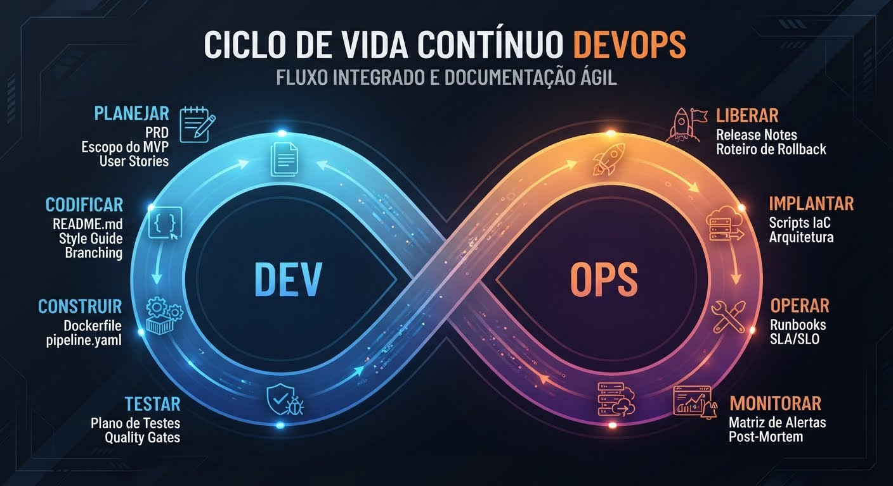

No contexto de desenvolvimento de software e DevOps, a expressão junta dois conceitos fundamentais que guiam a entrega de valor ágil: o MVP (Minimum Viable Product) e o PRD (Product Requirement Document).
Em suma, o "MVP PRD" é o Documento de Requisitos de Produto focado exclusivamente no escopo do Produto Mínimo Viável. É o mapa que define a versão mais simples de um produto que ainda entrega valor real ao usuário e pode ser lançada rapidamente.
Veja como esses conceitos se integram perfeitamente à cultura DevOps:

1. O que é cada componente?

• PRD (Documento de Requisitos de Produto): Tradicionalmente, é um documento que define o "o quê" e o "porquê" de um produto ou funcionalidade. Ele detalha o problema do cliente, o público-alvo, os requisitos de negócio, as funcionalidades necessárias e os critérios de sucesso.
• MVP (Produto Mínimo Viável): É a estratégia de desenvolver um novo produto com os recursos mínimos necessários para satisfazer os primeiros clientes e, o mais importante, coletar feedback para o aprendizado validado no ciclo futuro.

2. Como o "MVP PRD" funciona sob a ótica do DevOps?

No DevOps, o foco está na entrega contínua, ciclos de feedback rápidos e eliminação de desperdício. Um PRD tradicional e gigantesco (estilo Waterfall ou cascata) vai contra esses princípios. Por isso, o MVP PRD no DevOps é adaptado da seguinte forma:
• Foco em Requisitos Enxutos (Lean): O documento não tenta prever o produto final de daqui a dois anos. Ele lista apenas as funcionalidades cruciais para o MVP. Tudo o que for "desejável, mas não essencial" vai para o backlog futuro.
• Definição de Métricas de Feedback: Alinhado ao DevOps, o MVP PRD já nasce definindo como o sucesso será medido. Ele inclui requisitos de telemetria, observabilidade e ferramentas de análise de comportamento do usuário (ex: Google Analytics, Mixpanel, logs de erro) para coletar dados assim que o produto for lançado.
• Foco em Engenharia e Arquitetura Evolutiva: O documento define requisitos mínimos de infraestrutura (como microsserviços simples ou arquitetura serverless) que permitam o deploy rápido via esteiras de CI/CD (Integração e Entrega Contínuas), mas que consigam escalar depois.
• Alinhamento de Negócio e Operações: Ele serve como uma "ponte" viva entre o time de Produto (Product Owners/Managers), o time de Desenvolvimento (Dev) e o time de Infraestrutura (Ops), garantindo que todos saibam exatamente qual o escopo mínimo que precisa ser colocado em produção de forma segura.

Resumo das Diferenças

Característica	PRD Tradicional	MVP PRD (Cultura DevOps)
Tamanho/Escopo	Extenso, detalha o produto completo.	Enxuto, foca apenas no essencial para o lançamento.
Mudanças	Rígido, focado em evitar desvios de escopo.	Flexível, pronto para iterar com base em dados reais.
Métricas	Focado em prazos e entregas de escopo.	Focado em validação de hipóteses e telemetria.
Entrega	Grande lançamento (Big Bang).	Deploy frequente e melhoria contínua (CI/CD).

Se você estiver estruturando um para o seu time, eu posso te ajudar com o esqueleto. Você gostaria de ver um modelo/template simplificado de um MVP PRD focado em DevOps ou prefere focar em como definir as métricas de sucesso para o seu produto?

No DevOps, o desenvolvimento de aplicações não segue um modelo linear com início, meio e fim. Em vez disso, ele funciona como um ciclo contínuo em formato de infinito (∞), onde o software é constantemente aprimorado com base no feedback dos usuários.
As 8 etapas do ciclo de vida DevOps são divididas em duas grandes fases: a de desenvolvimento (Dev) e a de operações (Ops).
   [ Planejar ] ➔ [ Codificar ] ➔ [ Construir ] ➔ [ Testar ]
        ▲                                             │
        │                                             ▼
   [ Monitorar ] ◄ [ Operar ] ◄ [ Implantar ] ◄ [ Liberar ]

Fase de Desenvolvimento (Dev)

1. Planejar (Plan)

O foco é alinhar as necessidades de negócio com o escopo técnica. O time de produto e engenharia definem os requisitos (geralmente usando o MVP PRD), criam as user stories e organizam as tarefas em um backlog.
• Práticas comuns: Metodologias Ágeis (Scrum/Kanban), planejamento de sprints.
• Ferramentas: Jira, Azure Boards, Trello.

2. Codificar (Code)

Os desenvolvedores escrevem o código da aplicação. Para garantir a colaboração sem caos, utiliza-se o controle de versão. O código é dividido em ramificações (branches) para que múltiplos devs trabalhem em paralelo.
• Práticas comuns: Revisão de código (Code Review), programação em par.
• Ferramentas: Git, GitHub, GitLab, Bitbucket.

3. Construir (Build)

O código escrito é compilado e transformado em um artefato executável. Esta etapa marca o início da esteira automatizada. Assim que o desenvolvedor envia o código para o repositório principal, o sistema cria o pacote da aplicação e gera as imagens (como containers).
• Práticas comuns: Integração Contínua (CI), automação de builds.
• Ferramentas: Jenkins, GitHub Actions, GitLab CI, Docker.

4. Testar (Test)

O artefato gerado passa por uma bateria de testes automatizados. O objetivo é encontrar falhas e vulnerabilidades o mais cedo possível (Shift-Left Testing). Se algum teste falhar, a esteira para e o time é notificado imediatamente.
• Práticas comuns: Testes unitários, testes de integração, testes de segurança (SAST/DAST).
• Ferramentas: JUnit, Selenium, SonarQube, Cypress.

Fase de Operações (Ops)

5. Liberar (Release)

O software testado é homologado e preparado para ir ao ar. Nesta etapa, decide-se se a versão está madura o suficiente para produção. A liberação pode ser automatizada ou exigir uma aprovação manual (uma "trava de segurança").
• Práticas comuns: Gerenciamento de versões, automação de aprovações.
• Ferramentas: AWS CodePipeline, Octopus Deploy, ArgoCD.

6. Implantar (Deploy)

O código é publicado no ambiente de produção e disponibilizado para os usuários. O DevOps prioriza deploys automatizados e técnicas que reduzem o tempo de inatividade (Downtime) a zero.
• Práticas comuns: Entrega Contínua (CD), Infraestrutura como Código (IaC), estratégias de deploy como Blue-Green ou Canary Deployment.
• Ferramentas: Kubernetes, Terraform, Ansible, AWS, Azure, GCP.

7. Operar (Operate)

A aplicação é mantida funcionando de forma estável e segura no ambiente real. O time de operações gerencia a infraestrutura, lida com picos de acessos e garante que o sistema esteja disponível e escalável.
• Práticas comuns: Automação de backups, auto-scaling, gerenciamento de patches de segurança.
• Ferramentas: Kubernetes, AWS CloudWatch, PagerDuty.

8. Monitorar (Monitor)

Coleta de dados sobre o comportamento do sistema e a experiência do usuário. Essa etapa fecha o ciclo do infinito, gerando insights, métricas de desempenho e logs de erros que servirão como base para o planejamento da próxima melhoria.
• Práticas comuns: Observabilidade, monitoramento de performance (APM), análise de logs.
• Ferramentas: Prometheus, Grafana, Datadog, ELK Stack (Elasticsearch, Logstash, Kibana).
Para que eu possa te ajudar a aplicar esse fluxo no seu cenário, me conte:
• O seu time já utiliza alguma ferramenta de CI/CD (como GitHub Actions ou Jenkins)?
• Você quer focar em entender melhor alguma etapa específica, como as estratégias de Deploy ou a parte de Testes Automatizados?

No ecossistema DevOps, a documentação mudou de formato: em vez de manuais gigantescos e estáticos, ela é viva, enxuta (Lean) e, muitas vezes, escrita em formato de código. O objetivo é documentar o suficiente para garantir autonomia e automação, sem burocratizar o processo.
Abaixo está o mapeamento dos principais documentos e artefatos de engenharia gerados ou consumidos em cada uma das 8 etapas do ciclo DevOps:

📋 Fase de Desenvolvimento (Dev)

1. Planejar (Plan)

• PRD (Product Requirement Document): O documento original que guia o "porquê" e o "o quê" do produto.
• Escopo do MVP: A definição estrita da menor versão viável do produto.
• User Stories e Backlog: Histórias de usuário com Critérios de Aceite claros, geralmente documentados diretamente em ferramentas como o Jira ou Azure Boards.

2. Codificar (Code)

• README.md: O arquivo mais importante do repositório. Explica o que é o projeto, como configurar o ambiente local de desenvolvimento e como rodar a aplicação.
• Guia de Estilo de Código (Style Guide / Linters): Documentação das regras de formatação e boas práticas de escrita de código do time.
• Git branching strategy: Documento curto que dita as regras de como usar o Git (ex: GitFlow, Trunk-Based Development).

3. Construir (Build)

• Dockerfile: O arquivo de configuração que documenta e automatiza a criação do ambiente onde a aplicação vai rodar (container).
• Configuração da Esteira de CI (ex: pipeline.yaml): O código que documenta e automatiza os passos que o servidor deve seguir para buildar a aplicação (ex: arquivos do GitHub Actions, GitLab CI ou Jenkinsfile).

4. Testar (Test)

• Plano de Testes / Matriz de Testes: Documento que detalha quais cenários precisam ser validados (testes unitários, integração, carga).
• Relatórios de Cobertura e Qualidade (Quality Gate Reports): Relatórios gerados automaticamente (como os do SonarQube) que documentam a porcentagem de cobertura de código por testes e identificam débitos técnicos.

🚀 Fase de Operações (Ops)

5. Liberar (Release)

• Changelog / Release Notes: Documento voltado para o usuário ou para o time interno listando todas as novas funcionalidades, correções de bugs (bugfixes) e melhorias daquela versão específica.
• Roteiro de Rollback: Plano documentado detalhando as ações necessárias para desfazer a liberação caso um erro grave aconteça em produção.

6. Implantar (Deploy)

• Scripts de IaC (Infraestrutura como Código): Arquivos do Terraform, Ansible ou CloudFormation. Eles são a própria documentação da infraestrutura de servidores e redes.
• Diagrama de Arquitetura de Nuvem: Desenho técnico que ilustra como os componentes se comunicam na nuvem (AWS, Azure, GCP).

7. Operar (Operate)

• Playbook / Runbook: Manuais práticos passo a passo criados para o time de plantão (SRE/Ops). Eles dizem exatamente o que fazer quando um alarme específico tocar (ex: "Se o banco de dados atingir 95% de uso de CPU, siga estes passos").
• Políticas de SLA, SLO e SLI: Documento de governança que define os níveis de serviço acordados com o negócio (ex: o sistema deve ficar 99.9% do tempo online).

8. Monitorar (Monitor)

• Matriz de Monitoramento e Alertas: Documento que define quais métricas devem ser observadas e quais gatilhos disparam alertas para o time (ex: alertas no Slack ou PagerDuty).
• Post-Mortem (Análise Pós-Incidente): Documento gerado após uma falha grave em produção. Ele detalha cronologicamente o que aconteceu, por que aconteceu (causa raiz) e quais ações serão tomadas para que o erro nunca mais se repita.
Se você estiver precisando estruturar a documentação de um projeto atual, me conte:
• Qual dessas etapas ou documentos você precisa criar ou melhorar no momento?
• Você gostaria de um modelo (template) prático de um desses documentos, como um Runbook de operações ou um README de desenvolvimento?

